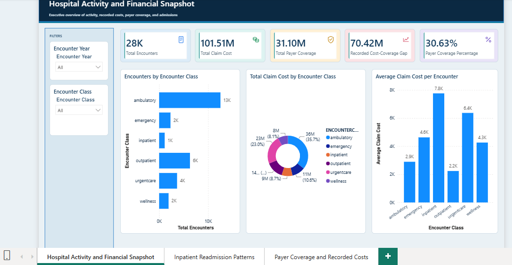
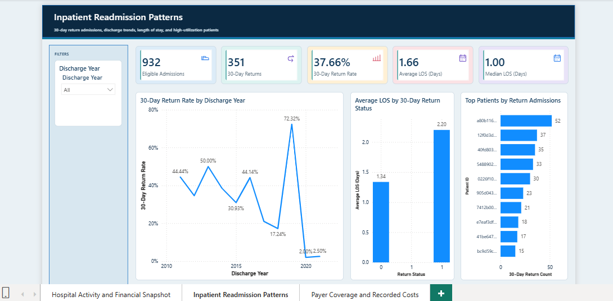
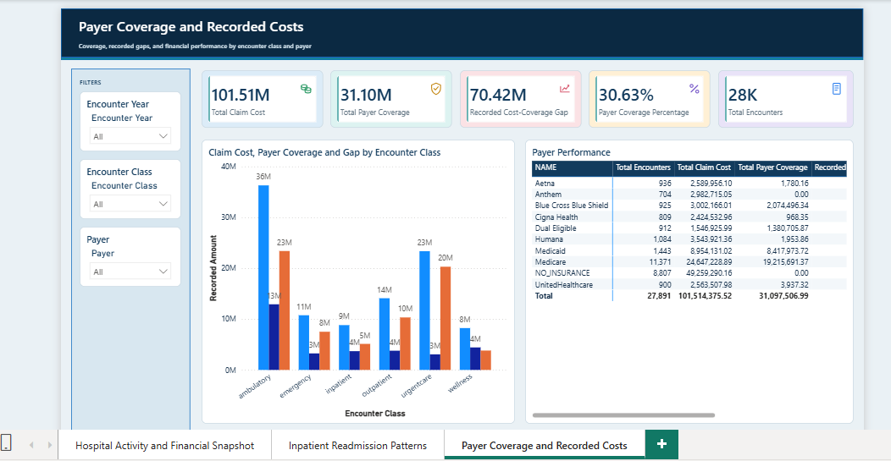

# Hospital Analytics

Power BI PBIP/PBIR portfolio project for hospital activity, recorded costs, payer coverage, and inpatient readmission analysis.

This public-release candidate contains a validated Power BI analytical report and its report/semantic-model definitions. It does **not** contain the complete upstream data-preparation pipeline, source rows, or credentials required to independently reproduce a fresh source refresh.

## Dataset attribution

The source dataset was downloaded from [Maven Analytics Data Playground — Hospital Patient Records](https://mavenanalytics.io/data-playground/hospital-patient-records). Maven identifies **SyntheticMass** as the source, describes the records as synthetic data, and lists the dataset license as **Public Domain**. The page links SyntheticMass to [Synthea](https://synthea.mitre.org/), the synthetic-healthcare-data generator.

Maven Analytics is credited as the distributor, SyntheticMass as the dataset source, and Synthea as the generator referenced by the official dataset page. This project does not claim ownership of the upstream dataset or dataset-derived content.

## What is included

- `HospitalAnalytics.pbip` — Power BI project entry point.
- `HospitalAnalytics.Report/` — three-page PBIR report definition and embedded KPI icon resources.
- `HospitalAnalytics.SemanticModel/` — TMDL semantic model, partitions, measures, and relationships.
- `build-report.js` — deterministic local report-authoring generator.
- `sql/validation/Validate_BigQuery.sql` — verified validation queries for the source tables.
- `docs/` — methodology, analytical decisions, source mapping, data dictionary, and reproduction notes.

This repository contains a validated Power BI analytical report and its semantic-model/report definitions. It does **not** contain the complete upstream data-preparation pipeline, source rows, or credentials required to independently reproduce a fresh source refresh.

## Dashboard pages

1. **Hospital Activity and Financial Snapshot** — encounter volume, recorded claims, payer coverage, coverage gap, and encounter-class analysis.
2. **Inpatient Readmission Patterns** — eligible admissions, observed 30-day returns, return rate, length of stay, annual trends, and top returning patients.
3. **Payer Coverage and Recorded Costs** — financial comparison by encounter class and payer-level performance.

## Dashboard showcase

### Hospital Activity and Financial Snapshot



### Inpatient Readmission Patterns



### Payer Coverage and Recorded Costs



## Verified baseline targets

These values were validated against the imported semantic model in the unfiltered report context:

| Metric | Value |
|---|---:|
| Total Encounters | 27,891 |
| Total Claim Cost | 101,514,375.52 |
| Total Payer Coverage | 31,097,506.99 |
| Recorded Cost-Coverage Gap | 70,416,868.53 |
| Payer Coverage Percentage | 30.63% |
| Total Inpatient Admissions | 934 |
| Eligible Admissions | 932 |
| 30-Day Returns | 351 |
| 30-Day Return Rate | 37.66% |
| Average LOS | approximately 1.66 days |
| Median LOS | 1.00 day |

Financial values are recorded source amounts. The source currency is not specified in the imported model, and the recorded gap is not asserted to be patient liability.

## Reproduce locally

1. Install Power BI Desktop and the local `powerbi-report-author` CLI.
2. Open `HospitalAnalytics.pbip` in Power BI Desktop.
3. Validate the report definition:

   ```powershell
   powerbi-report-author validate .\HospitalAnalytics.Report
   ```

4. Open the report and refresh only when valid source credentials and access to the configured BigQuery tables are available.

The public candidate is intentionally sanitized: its TMDL and validation SQL use `YOUR_GCP_PROJECT` and `YOUR_BIGQUERY_DATASET` placeholders. Reconfigure the BigQuery partitions before refreshing. The project is an editable PBIP/PBIR artifact, not a self-contained PBIX with embedded source rows. See [`docs/reproduction-notes.md`](docs/reproduction-notes.md) and [`docs/release-manifest.md`](docs/release-manifest.md) for known gaps.

## Licensing and attribution

`LICENSE` applies only to original repository code and documentation where the author has the right to license it. It does not grant rights to the upstream BigQuery data, dataset-derived content, Power BI or Microsoft schemas/tools, embedded report resources, or the dashboard screenshots. Dataset provenance and a third-party license were not present in the available project files; obtain attribution and redistribution permission from the data owner before public release.

The official Maven page lists the upstream dataset as Public Domain, but retain the Maven/SyntheticMass/Synthea attribution above. The sanitized candidate does not disclose the original BigQuery project or schema identifiers; see [`docs/public-disclosure.md`](docs/public-disclosure.md).

## Release status

The final local PBIR validation completed with zero errors and zero warnings. This repository has not been pushed or published; GitHub publication requires maintainer approval.
